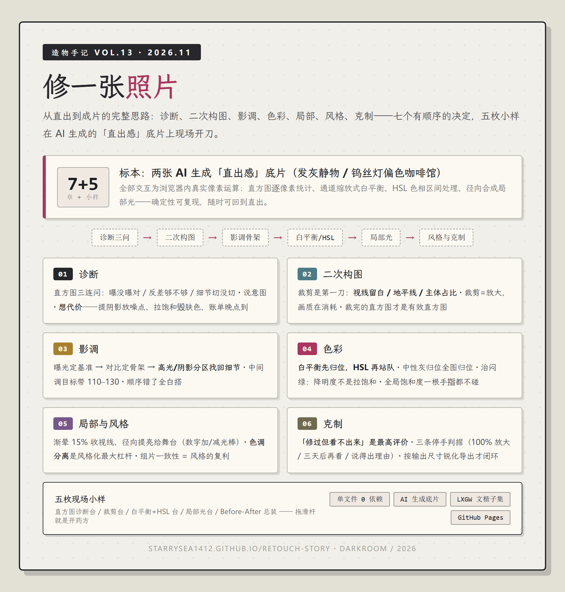

# 修一张照片 · 造物手记 VOL.13

> 从直出到成片的完整思路——诊断、二次构图、影调、色彩、局部、风格、克制：七个有顺序的决定，五枚小样在 AI 生成的「直出感」底片上现场开刀。

**在线阅读：<https://starrysea1412.github.io/retouch-story/>**

## 这篇讲什么

修图不是「加滤镜」，是一连串有顺序的决定。本篇把这套思路拆成七章，每一步都告诉你为什么是这个顺序、代价是什么：

| 章 | 主题 | 关键机制 |
|---|---|---|
| 01 | 修之前先诊断 | 直方图三连问 · 说意图 · 想代价 |
| 02 | 二次构图 | 视线留白 / 地平线 / 主体占比 · 裁剪=放大 |
| 03 | 影调骨架 | 曝光→对比→高光阴影分区 · 中间调目标带 |
| 04 | 白平衡与 HSL | 先归位再站队 · 治闷绿：降明度不是拉饱和 |
| 05 | 局部光 | 渐晕收视线 · 径向提亮给舞台 |
| 06 | 风格 | 色调分离 · teal&orange 不是万能钥匙 · 组片一致性 |
| 07 | 克制 | 三条停手判据 · 按输出尺寸锐化才闭环 |

## 五枚现场小样（真实像素运算）

1. **直方图诊断台** —— 曝光/对比滑杆，直方图实时搬家（逐像素统计）
2. **裁剪台** —— 三分网格 + 三种叙事预设（场景版/三分版/特写）
3. **白平衡 + HSL 台** —— 钨丝灯偏色归位 + 闷绿通道处理，双病例切换
4. **局部光台** —— 渐晕与主体提亮的克制区间
5. **Before/After 总装** —— 全管线一键应用，拖分割线对比直出/成片，可逐关步骤看贡献

底片为 AI 生成的「直出感」素材（刻意发灰/偏色），所有运算在浏览器内确定性发生。

## 系列

造物手记 VOL.13。往期：[VOL.12 住进机房的 Agent](https://starrysea1412.github.io/agent-patrol/) · [VOL.11 当 Agent 指挥 Agent](https://starrysea1412.github.io/agent-orchestrator/) · [番外 咔嚓！相机科普](https://starrysea1412.github.io/camera-primer/)

---

单文件 `index.html`（≈90KB + 三张素材）· 零依赖 · 字体 [LXGW 文楷](https://github.com/lxgw/LxgwWenKai)（OFL）· 插图与底片由 GPT 系图像模型生成
